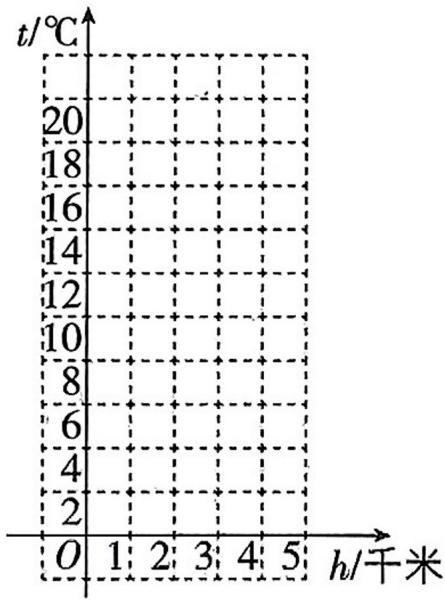

<!-- question-source:start -->
1 [2025 河北衡水质检]某地海拔 $h$ (千米)与此海拔处气温 $t(\mathrm{°C})$ 之间有下面的关系.

<table><tr><td>海拔h/千米</td><td>0</td><td>1</td><td>2</td><td>3</td></tr><tr><td>气温t/°C</td><td>20</td><td>14</td><td>8</td><td>2</td></tr></table>

(1)随着海拔的升高,气温\_\_\_\_(填“升高”或“下降”),因此自变量是\_\_\_\_;

(2)在如图所示的平面直角坐标系中描出表中 $(h, t)$ 对应的点；

(3)求气温 $t$ 与海拔 $h$ 之间的关系式；

(4)若该地某处的气温为 $-4^{\circ} \mathrm{C}$ , 求该处的海拔.

<!-- question-source:end -->

![[Q00105931A1]]
