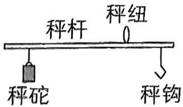
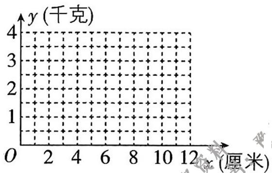

<!-- question-source:start -->
2 新考向传统文化 [2025 山东烟台期末]秤是我国传统的计重工具,方便了人们的生活. 如图(1),可以用秤砣到秤纽的水平距离得出秤钩上所挂物体的质量,称重时,秤杆上秤砣到秤纽的水平距离为 $x$ (厘米),秤钩所挂物体质量为 $y$ (千克). 下表为若干次称重时所记录的一些数据.

图(1)

<table><tr><td>x(厘米)</td><td>1</td><td>2</td><td>4</td><td>7</td><td>11</td><td>12</td></tr><tr><td>y(千克)</td><td>0.75</td><td>1.00</td><td>1.50</td><td>2.25</td><td>3.25</td><td>3.50</td></tr></table>

建议用时-20分钟 答案 D32

(1) 在图(2)中, 描出表中 $(x, y)$ 对应的点.

(2) 根据表格和描点发现:

①当秤杆上秤砣到秤纽的水平距离 x(厘米) 每增加 1 厘米时, 秤钩所挂物体质量 y(千克) 的具体变化是\_\_\_\_;

②当秤杆上秤砣到秤纽的水平距离为 14 厘米时,秤钩所挂物体质量是\_\_\_\_千克;

③直接写出 $y$ 与 $x$ 之间的关系式：\_\_\_\_。

(3)当秤钩所挂物体质量为 6.50 千克时,求秤杆上秤砣到秤纽的水平距离是多少厘米.

图(2)
<!-- question-source:end -->

![[Q00105932A1]]
