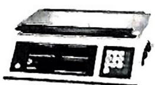
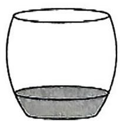

<!-- question-source:start -->
3 AI DPSK 原创 如图是称重时所用的电子秤, 将质量相同的瓶装可乐依次放在秤盘上. 随着所放可乐瓶数的增多, 显示屏上的数字会变大, 这样的变大\_\_\_\_(填“是”或“不是”)“均匀”变化的.

(第3题图)
(第4题图)
<!-- question-source:end -->

![[Q00105933A1]]
