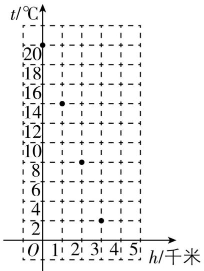

> [!success]- 必刷题
>
> > [!success] **【答案】** 下降,海拔 h
>
> > [!note]- **【解析】**
> > 【解】(1)由题表可知,随着海拔的升高,气温下降,因此自变量是海拔 h. 故答案为下降,海拔 h.
> >
> > (2)描点如下:
> >
> > 
> >
> > 关键点拨
> > 根据 $y=(m-3)x+1$ 是关于 x 的一次函数, 得出 $m-3\neq0$ 是解题关键.
> >
> > (3)由题表可知,海拔每上升1千米,气温下降6℃,所以t=20-6h.
> > (4)令 t=20-6h=-4, 解得 h=4, 所以该处的海拔是 4 千米.
