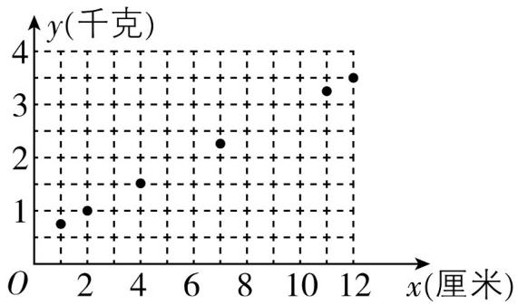

> [!success]- 必刷题
>
> > [!success] **【答案】** 增加 $\frac{1}{4}$ 千克
>
> > [!note]- **【解析】**
> > 【解】(1)描点如下:
> >
> > 
> >
> > (2)①当秤杆上秤砣到秤纽的水平距离 x (厘米) 每增加 1 厘米时, 秤钩所挂物体质量 y (千克) 的具体变化是增加 $\frac{1}{4}$ 千克. 故答案为增加 $\frac{1}{4}$ 千克.
> > - **②**：由题意得当秤杆上秤砣到秤纽的水平距离为 14 厘米时, 秤钩所挂物体质量是 $3.5 + \frac{1}{4} \times (14 - 12) = 4$ (千克). 故答案为 4.
> > - **③**：由题意得 $y = 0.75 + \frac{1}{4}(x - 1) = \frac{1}{4}x + \frac{1}{2}$ . 故答案为 $y = \frac{1}{4}x + \frac{1}{2}$ .
> >
> > (3) 当 y = 6.5 时, $\frac{1}{4}x + \frac{1}{2} = 6.5$ , 解得 x = 24, 所以当秤钩所挂物体质量为 6.50 千克时, 秤杆上秤砣到秤纽的水平距离是 24 厘米.
> >
> > 思路分析
> > (1) 由题表可知, 大蒜质量每增加 1 kg, 销售收入增加 10.5 元, 据此得到 y 与 x 之间的关系式, 再根据正比例函数的定义进行判断即可.
