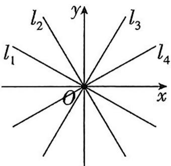
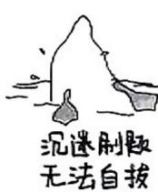

<!-- question-source:start -->
8[2025 河南郑州校级期中]如图,在同一平面直角坐标系中,正比例函数 $y = k_{1}x, y = k_{2}x, y = k_{3}x$ , $y = k_{4}x$ 的图象分别为 $l_{1}, l_{2}, l_{3}, l_{4}$ , 则 $k_{1}, k_{2}, k_{3}, k_{4}$ 的大小关系是\_\_\_\_。(用“<”连接)

<!-- question-source:end -->

![[Q00105952A1]]
