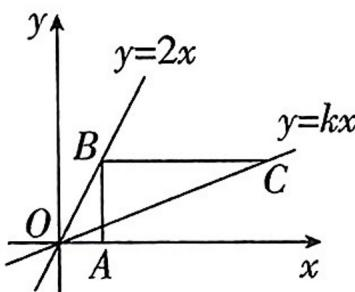
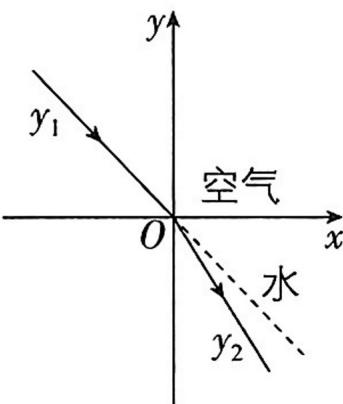

<!-- question-source:start -->
3 [2024 陕西宝鸡期末, 中] 如图, 点 $B$ 在直线 $y = 2x$ 上, 过点 $B$ 作 $BA \perp x$ 轴于点 $A$ , 作 $BC \parallel x$ 轴与直线 $y = kx (k \neq 0)$ 交于点 $C$ , 若 $AB: BC = 1: 2$ , 则 $k$ 的值是 ( )
A. $\frac{2}{7}$ B. $\frac{2}{3}$ C. $\frac{1}{3}$ D. $\frac{2}{5}$

(第3题图)

(第4题图)
<!-- question-source:end -->

![[Q00105957A1]]
