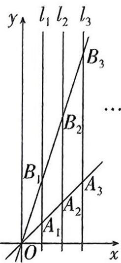

<!-- question-source:start -->
7 [2024 江苏连云港质检, 中] 如图, 直线 $l_{1} \perp x$ 轴于点 (1,0), 直线 $l_{2} \perp x$ 轴于点 (2,0), 直线 $l_{3} \perp x$ 轴于点 (3,0), $\cdots$ , 直线 $l_{n} \perp x$ 轴于点 (n,0)

$(n \geqslant 2 \text{ 且 } n \text{ 为整数}). \text{ 函数 } y = x$ 的图象与直线 $l_1, l_2, l_3, \cdots, l_n$ 分别交于点 $A_1, A_2, A_3, \cdots, A_n$ ; 函数 $y = 3x$ 的图象与直线 $l_1, l_2, l_3, \cdots, l_n$ 分别交于点 $B_1, B_2, B_3, \cdots, B_n$ , 如果 $\triangle OA_1B_1$ 的面积记作 $S_1$ , 四边形 $A_1A_2B_2B_1$ 的面积记作 $S_2$ , 四边形 $A_2A_3B_3B_2$ 的面积记作

$S_{3},\cdots$ , 四边形 $A_{n-1}A_{n}B_{n}B_{n-1}$ 的面积记作 $S_{n}$ , 那么 $S_{2024}=$ \_\_\_\_.
<!-- question-source:end -->

![[Q00105961A1]]
