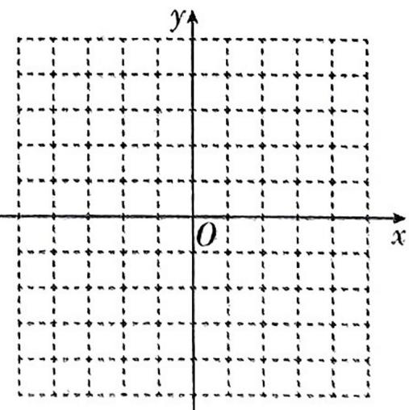

<!-- question-source:start -->
9 思想方法 数形结合 [2025 北京西城区校级期中, 中] 函数问题:

(1)已知函数 $y = 2|x|$ .

①自变量 $x$ 的取值范围是

②将下表补充完整,并在平面直角坐标系中画出函数 $y=2|x|$ 的图象:

<table><tr><td>x</td><td>...</td><td>-2</td><td>-1</td><td>0</td><td>1</td><td>2</td><td>...</td></tr><tr><td>y</td><td>...</td><td></td><td></td><td></td><td></td><td></td><td>...</td></tr></table>

③当自变量 x 的值从 1 增加到 2 时, 函数 y 的值增加了 \_\_\_\_.

(2)在一个变化的过程中,变量 x 与 y 之间可能是函数关系,也可能不是函数关系.
下列各式中,y 是 x 的函数的是\_\_\_\_.
① $x+y=1$ ;② $|x+y|=1$ ;③xy=1;④ $x^{2}+y^{2}=1$ .

<!-- question-source:end -->

![[Q00105963A1]]
