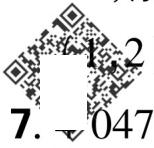

> [!success]- 必刷题
>
> > [!success] **【答案】** (1,2)或(-1,-2)
>
> > [!note]- **【解析】**
> > 因为直线 y=2x 上的点到 x 轴的距离是 2 ,所以 $y=\pm2$ . 当 y=2 时,即 2x=2 ,解得 x=1 ;当 y=-2 时,即 2x=-2 ,解得 x=-1 ,所以符合条件的点的坐标为 -1,2 )或(-1,-2).
> >
> > 
