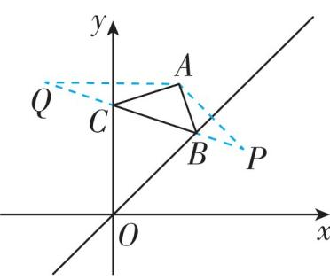

> [!success]- 必刷题
>
> > [!success] **【答案】** $\sqrt{10}$
>
> > [!note]- **【解析】**
> > 作 A 点关于直线 y = x 的对称点 P，关于 y 轴的对称点 Q，连接 PQ 交直线 y = x 于
> >
> > B, 交 y 轴于 C, 如图. 因为 AC = CQ, BP = AB, 所以 $C_{\triangle ABC} = AC + CB + AB = CQ + CB + BP$ . 因为 P, B, C, Q 四点共线, 所以此
> >
> > 
> >
> > 时 $\triangle ABC$ 周长最小, 最小值为 $PQ$ 的长度. 由 $A(1,2)$ 易知 $Q(-1,2), P(2,1)$ , 所以 $PQ = \sqrt{(-1 - 2)^2 + (2 - 1)^2} = \sqrt{10}$ , 则 $\triangle ABC$ 周长的最小值为 $\sqrt{10}$ , 故答案为 $\sqrt{10}$ .
> >
> > ## 刷素养·
