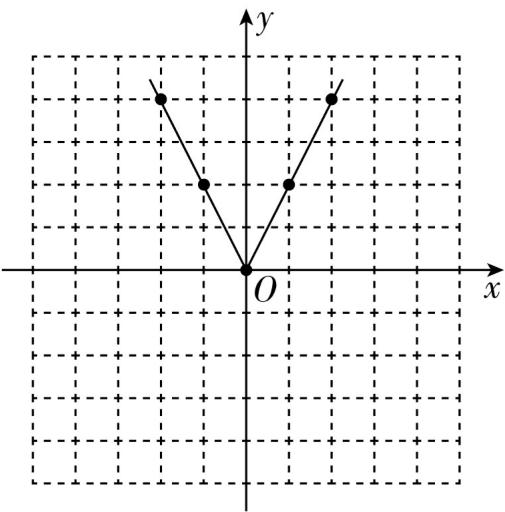

> [!success]- 必刷题
>
> > [!success] **【答案】** 任意实数
>
> > [!note]- **【解析】**
> > 【解】(1)①自变量 x 的取值范围是任意实数.
> > 故答案为任意实数.
> > - **②**：分别将 x = -2, -1, 0, 1, 2 代入 y = 2|x|，得 y = 4, 2, 0, 2, 4. 故答案为 4, 2, 0, 2, 4.
> > 函数 y = 2|x| 的图象如图所示.
> >
> > 
> > - **③**：当自变量 x 的值从 1 增加到 2 时, 函数 y 的值增加了 2. 故答案为 2.
> >
> > (2)根据函数的定义可知,①③中对于变量 x 的每一个值,变量 y 都有唯一的值与它对应,故 y 是 x 的函数的是①③.故答案为①③.
> >
> > ## 课时 2 一次函数的图象和性质
