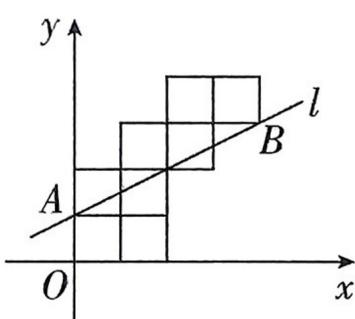

<!-- question-source:start -->
3 [2025 辽宁沈阳期中] 如图, 将 8 个边长均为 1 的小正方形摆放在平面直角坐标系中, 直线 $l$ 经过小正方形的顶点 $A, B$ , 则直线 $l$ 的函数表达式为

函数表达式为 ( )
A. $y=\frac{1}{2}x+1$ B. $y=\frac{1}{3}x+1$ C. $y=\frac{2}{3}x+1$ D. $y=\frac{3}{4}x+1$
<!-- question-source:end -->

![[Q00105982A1]]
