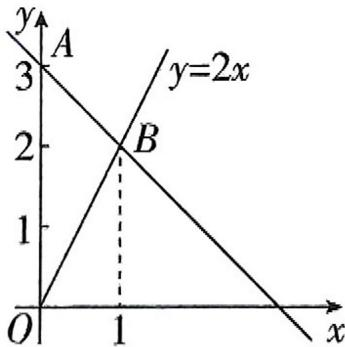

<!-- question-source:start -->
4[2025 四川内江质检]如图, 过点 $A$ 的一次函数的图象与正比例函数 $y = 2x$ 的图象相交于点 $B$ , 则这个一次函数的表达式是 ( )
A. $y = -x + 3$ B. $y = -2x+$ C. $y = 2x - 3$ D. $y = -x - 3$

<!-- question-source:end -->

![[Q00105983A1]]
