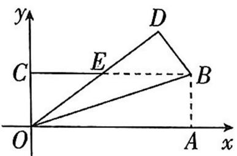
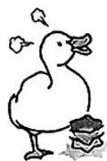

<!-- question-source:start -->
2[2025 山西太原质检, 中]如图, 在平面直角坐标系中, 四边形 $AOCB$ 是长方形, $A(9,0), B(9,3), C(0,3)$ . 将 $\triangle OAB$ 沿直线 $OB$ 折叠, 此时点 $A$ 落在点 $D$ 处, $OD$ 与 $BC$ 交于点 $E$ , 且 $OE=BE$ , 则 $OD$ 所在直线的函数表达式为 ( )

不做题
我就跺脚鸭

A. $y = \frac{4}{5} x$ B. $y = \frac{5}{4} x$ C. $y = \frac{3}{4} x$ D. $y = \frac{4}{3} x$
<!-- question-source:end -->

![[Q00105990A1]]
