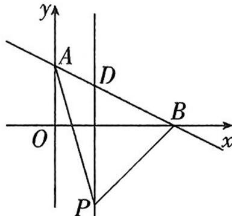

<!-- question-source:start -->
7 铅垂法 [2025 江苏无锡调研, 中] 如图, 平面直角坐标系中, 直线 $AB: y = kx + b$ 交 $y$ 轴于点 $A(0,3)$ , 交 $x$ 轴于点

$B(6,0)$ ，直线 x=2 交 AB 于点 D。若点 P 坐标为 $(2,-4)$ ，连接 AP, BP，则 $\triangle ABP$ 的面积是 \_\_\_\_.
<!-- question-source:end -->

![[Q00105995A1]]
