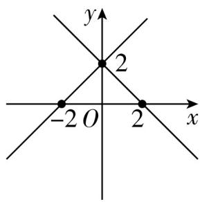

> [!success]- 必刷题
>
> > [!success] **【答案】** C
>
> > [!note]- **【解析】**
> > 因为一次函数 $y = kx + b (k \neq 0)$ 图象过点(0, 2)，所以 $b = 2$ 。因为一次函数图象与两坐标轴围成的三角形面积为 2，所以该一次
> >
> > 
> >
> > 函数图象过点(2,0)或(-2,0)，如图所示. 将(2,0)代入 $y = kx + 2$ 中，解得 $k = -1$ ; 将(-2,0)代入 $y = kx + 2$ 中，解得 $k = 1$ ，则一次函数的表达式是 $y = x + 2$ 或 $y = -x + 2$ .
> >
> > 故选 **C**.
