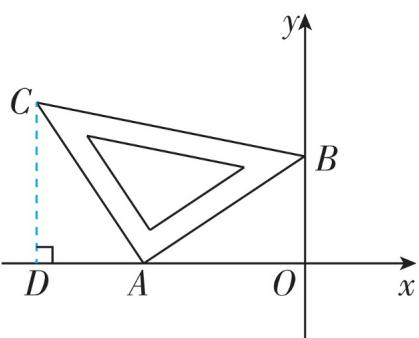
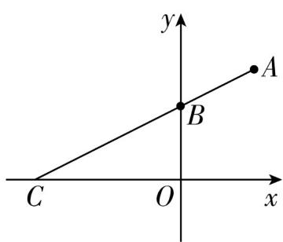

> [!success]- 必刷题
>
> > [!success] **【答案】** $y = -\frac{1}{5} x + 2$
>
> > [!note]- **【解析】**
> > 如图所示, 过点 $C$ 作 $\overline{CD \perp x}$ 轴于点 $D$ , 所以 $\angle CDA = 90^\circ$ , 所以 $\angle ACD + \angle CAD = 90^\circ$ . 由题意得 $\angle CAB = 90^\circ$ , 所以 $\angle CAD + \angle BAO = 90^\circ$ , 所以 $\angle ACD = \angle BAO$ . 又因为 $CA = AB$ , $\angle AOB = \angle CDA = 90^\circ$ , 所以 $\triangle ACD \cong \triangle BAO(AAS)$ . 因为 $A(-3,0)$ , $B(0,2)$ , 所以 $AO = 3$ , $BO = 2$ , 所以 $AO = CD = 3$ , $AD = OB = 2$ , 所以 $DO = 5$ , 所以 $C(-5,3)$ . 设直线 $BC$ 的函数表达式为 $y = kx + b$ , 将 $B(0,2)$ , $C(-5,3)$ 代入, 得 $-5k + b = 3$ , $b = 2$ , 解得 $k = -\frac{1}{5}$ , $b = 2$ , 所以 $y = -\frac{1}{5} x + 2$ . 故答案为 $y = -\frac{1}{5} x + 2$ .
> >
> > 
> > (第3题图)
> >
> > 
> > (第4题图)
