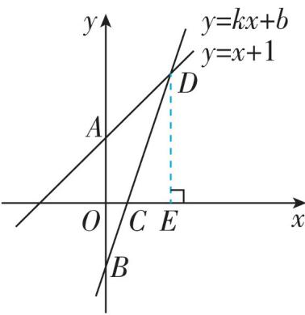

> [!success]- 必刷题
>
> > [!success] **【答案】** 18
>
> > [!note]- **【解析】**
> > 对于直线 $y = x + 1$ ，令 $x = 0$ ，则 $y =$
> >
> > 方法技巧
> > 当所求图形面积不能用面积公式直接求出时,通常用割补法将所求图形面积转化为几个规则图形的面积和或差的形式.
> >
> > ## 关键点拨
> >
> > (3)本题考查一次函数的综合应用,解题关键是理解题干的新定义,通过直线经过定点,结合图象即可求解.
> >
> > 1, 即 $A(0,1)$ , 所以 $OA = 1$ . 把 $D(1,n)$ 代入 $y = x + 1$ , 得 $n = 2$ , 即 $D(1,2)$ . 把 $D(1,2), B(0,-1)$ 代入 $y = kx + b$ 中, 得 $b = -1$ , $k = 3$ , 所以直线 $CD$ 的表
> >
> > 
> >
> > 达式为 $y = 3x - 1$ 。令 $y = 0$ ，则 $3x - 1 = 0$ ，解得 $x = \frac{1}{3}$ ，所以 $C\left(\frac{1}{3}, 0\right)$ ，所以 $OC = \frac{1}{3}$ 。作 $DE \perp x$ 轴于 $E$ ，如图，则 $DE = 2, E(1, 0)$ ，所以 $OE = 1$ ，所以 $CE = 1 - \frac{1}{3} = \frac{2}{3}$ ，所以 $S_{\text{四边形}AOCD} = S_{\text{梯形}AOED} - S_{\triangle CDE} = \frac{1}{2}(AO + DE) \cdot OE - \frac{1}{2}CE \cdot DE = \frac{1}{2} \times (1 + 2) \times 1 - \frac{1}{2} \times \frac{2}{3} \times 2 = \frac{3}{2} - \frac{2}{3} = \frac{5}{6}$ .
> >
> > 7.18 【解析】把 $A(0,3), B(6,0)$ 代入 $y = kx + b$ ，得 $b = 3$ ，① $6k + b = 0$ ，② 将①代入②，得 $k = -\frac{1}{2}$ ，所以直线 $AB$ 的表达式为 $y = -\frac{1}{2}x + 3$ 。为点 $D$ 在直线 $AB$ 上，且点 $D$ 的横坐标为 2，所以把 $x = 2$ 代入 $y = -\frac{1}{2}x + 3$ ，得 $y = 2$ ，所以 $D(2,2)$ 。因为 $P(2,-4), D(2,2)$ ，所以 $PD = 2-(-4) = 6$ ，所以 $S_{\triangle PAB} = S_{\triangle PDA} + S_{\triangle PDB} = \frac{1}{2} \times PD \times (x_B - x_A) = \frac{1}{2} \times 6 \times 6 = 18$ 。故答案为 18。
> >
> > ## 刷素养·
