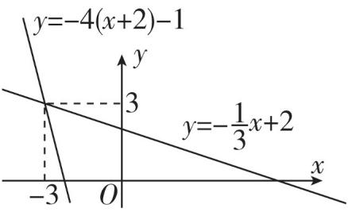
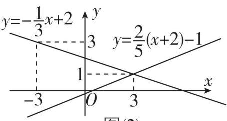

> [!success]- 必刷题
>
> > [!success] **【答案】** $(3, \sqrt{3})$
>
> > [!note]- **【解析】**
> > 【解】(1)因为 $y = kx - 3k + \sqrt{3} = k(x - 3) + \sqrt{3}$ ，所以点 $A$ 坐标为 $(3, \sqrt{3})$ . 故答案为 $(3, \sqrt{3})$ .
> >
> > (2)由题意可得点 $B$ 的“友好线”的表达式为 $y = k(x - 3) + 2$ ，将 $(1, 1)$ 代入 $y = k(x - 3) + 2$ 得 $1 = -2k + 2$ ，解得 $k = \frac{1}{2}$ ，所以该“友好线”的表达式为 $y = \frac{1}{2}(x - 3) + 2$ .
> >
> > (3)把 $x = -3$ 代入 $y = -\frac{1}{3}x + 2$ ，得 $y = 3$ ，把 $x = 3$ 代入 $y = -\frac{1}{3}x + 2$ ，得 $y = 1$ ，所以直线 $y = -\frac{1}{3}x + 2$ 经过点 $(-3, 3)$ ， $(3, 1)$ . 把 $(-3, 3)$ 代入 $y = k(x + 2) - 1$ 得 $-k - 1 = 3$ ，解得 $k = -4$ ，把 $(3, 1)$ 代入 $y = k(x + 2) - 1$ 得 $5k - 1 = 1$ ，解得 $k = \frac{2}{5}$ . 直线 $y = k(x + 2) - 1$ 经过定点 $(-2, -1)$ ， $k = -4$ 时, 图象如图(1)所示; $k=\frac{2}{5}$ 时, 图象如图(2)所示, 所以由题意得 k 的取值范围为 $-4 \leqslant k < 0$ 或 $0 < k \leqslant \frac{2}{5}$ .
> >
> > 
> > 图(1)
> >
> > 
> > 图(2)
> >
> > ## 课时 2 单个一次函数图象的实际应用
