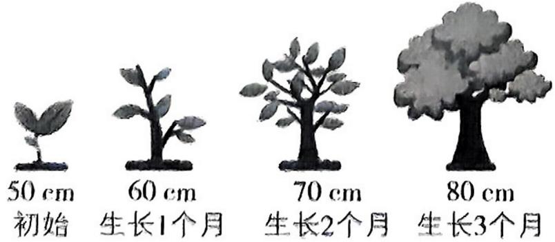

<!-- question-source:start -->
5[2025 宁夏银川校级期中]某树苗的初始高度为 50 cm, 如图, 这是该树苗的高度与生长的月数的有关数据示意图, 假设以后一段时间内, 该树苗高度的变化与月数保持此关系, 则该树苗的高度 $y(\text{cm})$ 与生长月数 x 之间的函数关系式为 ( )

建议用时 20 分钟 答案 D32

A. $y = 50 + 5(x - 1)$ B. $y = 50 + 5x$ C. $y = 50 + 10(x - 1)$ D. $y = 50 + 10x$
<!-- question-source:end -->

![[Q00105936A1]]
