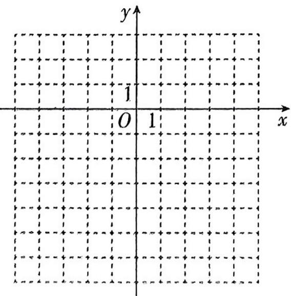

<!-- question-source:start -->
4[2025 陕西西安质检]将表格补充完整,并根据表中的数据在如图所示的平面直角坐标系中画出一次函数 $y = 2x - 6$ 的图象.
(1) 列表:

<table><tr><td>x</td><td>0</td><td></td></tr><tr><td>y=2x-6</td><td></td><td>0</td></tr></table>

(2)描点、连线,画出一次函数 $y = 2x - 6$ 的图象.

建议用时 20 分钟 答案 D35
<!-- question-source:end -->

![[Q00105967A1]]
