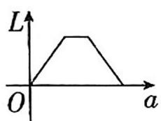
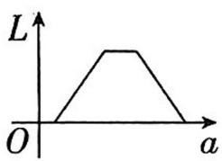
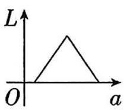
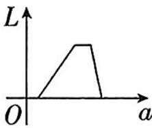
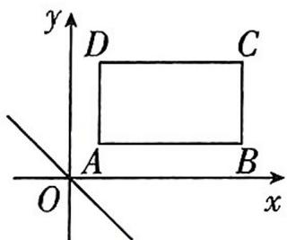
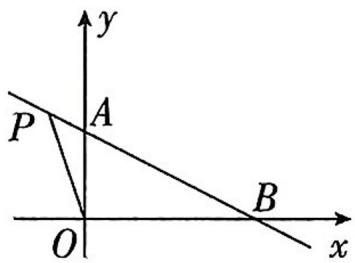

<!-- question-source:start -->
2[2025 福建福州期中, 中]如图, 在平面直角坐标系中, 长方形 ABCD 在第一象限, 且 $AB \parallel x$ 轴. 将直线 y = -x 从原点 O 开始沿 x 轴正方向匀速平移, 直线被长方形 ABCD 截得的线段的长度 L 与平移的距离 a 之间的函数关系的大致图象可能是 ( )

A

B

C

D

(第2题图)

(第3题图)
<!-- question-source:end -->

![[Q00105975A1]]
