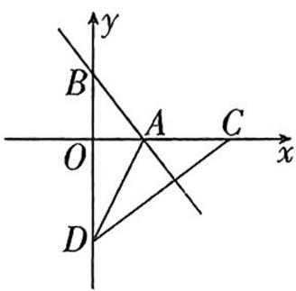

<!-- question-source:start -->
5[2024 福建龙岩期末, 中]如图, 在平面直角坐标系 $xOy$ 中, 直线 $y = -\frac{4}{3} x + 4$ 与 $x$ 轴、 $y$ 轴分别交于点 $A, B$ , 点 $D$ 在 $y$ 轴的负半轴上, 将 $\triangle DAB$ 沿直线 AD 折叠, 点 B 恰好落在 x 轴正半轴上的点 C 处.

(1) 求 $AB$ 的长.

(2)求点 $C$ 和点 $D$ 的坐标.

(3) $y$ 轴上是否存在一点 $P$ , 使得 $S_{\triangle PAB} = \frac{1}{2} S_{\triangle OCD}$ ? 若存在, 直接写出点 $P$ 的坐标; 若不存在, 请说明理由.

<!-- question-source:end -->

![[Q00105978A1]]
