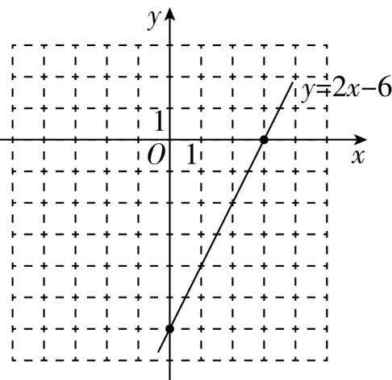

> [!success]- 必刷题
>
> > [!success] **【答案】** 详见解析
>
> > [!note]- **【解析】**
> > 【解】(1) 将 $x = 0$ 代入 $y = 2x - 6$ , 得 $y = -6$ ; 将 $y = 0$ 代入 $y = 2x - 6$ , 得 $2x - 6 = 0$ , 解得 $x = 3$ . 故答案从左到右为 $-6, 3$ .
> >
> > (2)一次函数 $y = 2x - 6$ 的图象如图所示.
> >
> > 
