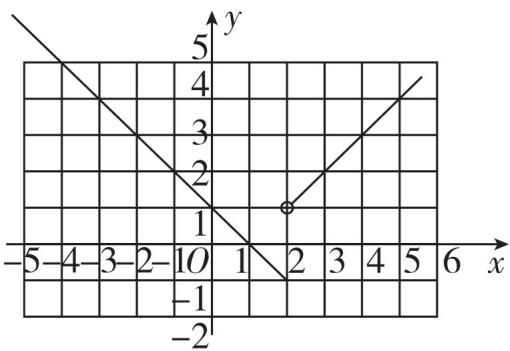

> [!success]- 必刷题
>
> > [!success] **【答案】** $\left\{\begin{aligned}-x+1(x&\leqslant0),\\ x-1(x&>0)
>
> > [!note]- **【解析】**
> > 【解】(1)由题意可得,函数 $y = -x + 1$ 的“0变换函数”为 $y = \begin{cases} -x + 1 (x \leqslant 0), \\ x - 1 (x > 0). \end{cases}$ 故答案为 $\left\{\begin{aligned}-x+1(x&\leqslant0),\\ x-1(x&>0).\end{aligned}\right.$ (2) $y = -x + 1$ 的“2变换函数”为 $y = \left\{\begin{aligned}-x+1(x&\leqslant2),\\ x-1(x&>2)\end{aligned}\right.$ 图象如图所示.
> >
> > 
> > - **①**：当 $x = 3$ 时， $y = 3 - 1 = 2$ . 当 $y = 2$ 时， $-x + 1 = 2$ 或 $x - 1 = 2$ ，解得 $x = -1$ 或 $x = 3$ .
> > - **②**：当 $-3 \leqslant x \leqslant 2$ 时， $y = -x + 1, y$ 随 $x$ 的增大而减小，所以 $-1 \leqslant y \leqslant 4$ ; 当 $2 < x \leqslant 3$ 时， $y = x - 1, y$ 随 $x$ 的增大而增大, 所以 $1 < y \leqslant 2$ . 综上所述, $-1 \leqslant y \leqslant 4$ . 故答案为 $-1 \leqslant y \leqslant 4$ .
> >
> > (3) $a < -1$ 或 $a \geqslant 3$ . 由 (2) 可知, 在函数 $y = -x + 1$ 的 “2 变换函数” 中, $y = 2$ 时, $x = -1$ 或 $x = 3$ , 所以当一次函数 $y = -x + 1$ 的 “ $a$ 变换函数” 的图象与直线 $y = 2$ 有一个交点时, $a < -1$ 或 $a \geqslant 3$ .
> >
> > ## 4 一次函数的应用
> >
> > ## 课时1 确定一次函数的表达式
