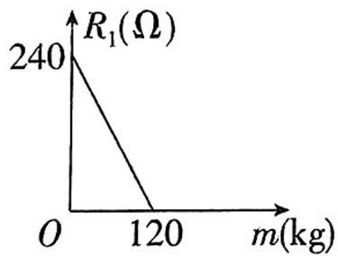

<!-- question-source:start -->
2[2025 河南郑州期末]某电子体重秤的原理是当人站立在秤面上后,应变传感上的应变片发生位移,从而改变电阻值,通过电阻值的变化,即可准确测量体重.简易电子秤制作方法:制作一个装有踏板(踏板质量忽略不计)的可变电阻 $R_{1}$ ,已知 $R_{1}(\Omega)$ 与踏板上人的质量 $m(\mathrm{kg})$ 之间的函数关系式为 $R_{1}=km+b$ (其中 $k,b$ 为常数, $0 \leqslant m \leqslant 120$ ),其图象如图所示.下列说法不正确的是()

A. $b = 240$ B. 可变电阻 $R_{1}$ 随着踏板上人的质量 $m$ 的增加而减小
C. 踏板上人的质量 $m$ 每增加 $10 \mathrm{~kg}$ , 可变电阻 $R_{1}$ 减小 $20 \Omega$ D. 当可变电阻 $R_{1}$ 为 $90 \Omega$ 时, 对应测得人的质量 $m$ 为 $60 \mathrm{~kg}$
<!-- question-source:end -->

![[Q00105997A1]]
