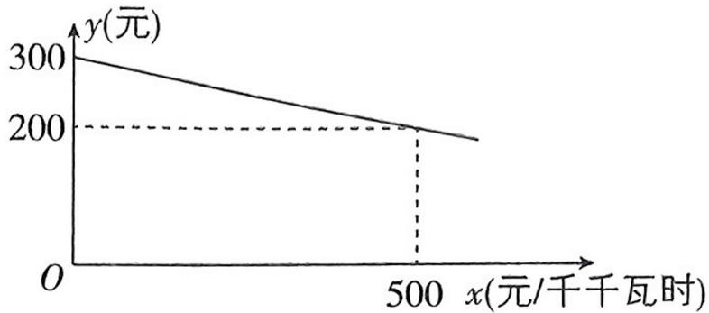

<!-- question-source:start -->
3[2025 湖北黄冈质检]某工厂在生产过程中要消耗大量电能,经过测算,该工厂消耗每千千瓦时电产生的利润 y(元)与电价 x(元/千千瓦时)有如图所示的一次函数关系,则当该工厂消

建议用时 20 分钟 答案 D39

耗每千千瓦时电产生的利润是180元时,电价x为\_\_\_\_元/千千瓦时.

<!-- question-source:end -->

![[Q00105998A1]]
