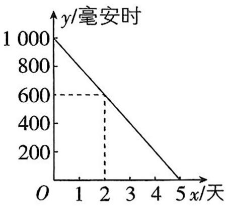

<!-- question-source:start -->
4[2025 广东深圳校级期中]某手机的电板剩余电量 $y$ (毫安时)是使用天数 $x$ (天)的一次函数, 函数图象如图所示. (1) 此种手机的电板最大带电量是\_\_\_\_毫安时, 在充满电时最多可供手机消耗\_\_\_\_天, 每天消耗电量\_\_\_\_毫安时; (2) 求 $y$ 与 $x$ 之间的函数关系式 $y = kx + b$ , 并说出 $k$ 和 $b$ 的实际意义; (3) 若此种手机电量剩余 400 毫安时就会发出提示音, 则在手机充满电使用\_\_\_\_天后, 手机会发出提示音?

<!-- question-source:end -->

![[Q00105999A1]]
