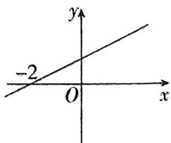

<!-- question-source:start -->
5[2025 福建福州期中]函数 $y = -kx + 1 (k \neq 0)$ 的图象如图所示, 则方程 $-kx + 1 = 0$ 的解是()

A. $x = -2$ B. $x = -1$ C. $x = 0$ D. $x = 1$

<!-- question-source:end -->

![[Q00106000A1]]
