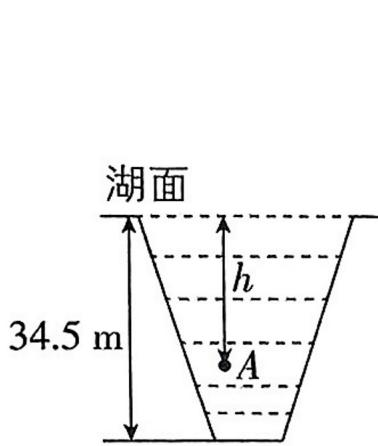
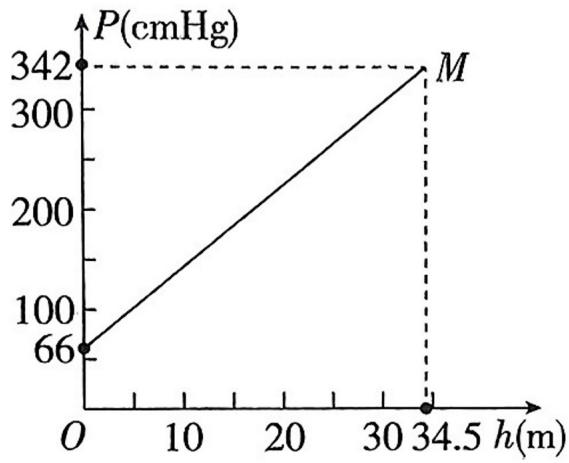

<!-- question-source:start -->
1 [2025 山东济南期中, 中] 如图(1)是某湖最深处的截面图, 湖面下任意一点 A 的压强 P (单位: cmHg) 与其深度 h (单位: m) 的函数关系式为 $P = ah + P_{0}$ , 其图象如图(2)所示, 其中 $P_{0}$ 为湖面大气压强, a 为常数且 a > 0, 点 M 的坐标为 (34.5, 342). 根据图中信息分析, 下列结论正确的是 ( )

图(1)

图(2)

A. 湖面大气压强为 $76.0 \mathrm{~cmHg}$ B. 函数表达式 $P = ah + P_{0}$ 中 $P$ 的取值范围是 $P < 342$ C. 湖水深 $20 \mathrm{~m}$ 处的压强为 $256 \mathrm{~cmHg}$ D. $P$ 与 $h$ 的函数表达式为 $P = 8h + 66 (0 \leqslant h \leqslant 34.5)$
<!-- question-source:end -->

![[Q00106002A1]]
