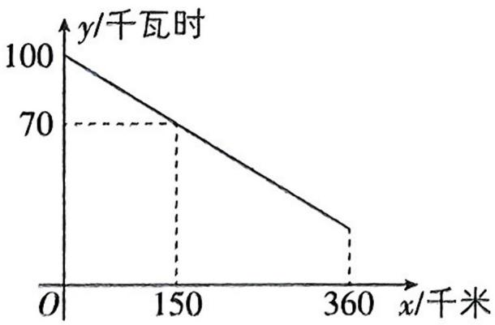

<!-- question-source:start -->
3[2025 四川成都期末, 中]我国新能源汽车快速健康发展, 续航里程不断提升. 王师傅驾驶一辆纯电动汽车从一高速公路入口 A 驶入时, 该车的剩余电量是 100 千瓦时, 行驶了 360 千米后, 从另一高速公路出口 B 驶出. 已知该车在高速公路上行驶的过程中, 剩余电量 $y$ (千瓦时)与行驶路程 $x$ (千米)之间的关系如图所示.

(1) 求 $y$ 关于 $x$ 的函数表达式；

(2) 若这辆车从高速公路入口 A 驶入时, 剩余电量为 78 千瓦时,请问王师傅能在不充电的情况下行驶 360 千米到达高速公路出口 B 吗?说明理由.
<!-- question-source:end -->

![[Q00106004A1]]
