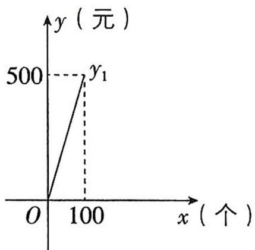
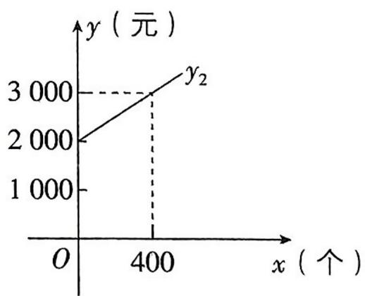

<!-- question-source:start -->
4[2025 辽宁丹东质检,较难]某公司需要一批食品包装盒,有两种方案可供选择:方案一:从包装盒加工厂直接购买,购买所需的费用 $y_{1}$ (元)与包装盒数x(个)满足如图(1)所示的函数关系.方案二:租赁机器自己加工,所需费用(包括租赁机器的费用和生产包装盒的费用) $y_{2}$ (元)与包装盒数x(个)满足如图(2)所示的函数关系.根据图象回答下列问题:(1)方案一中包装盒的单价是多少?(2)方案二中租赁机器的费用是多少?生产的包装盒的单价是多少?(3)请分别求出 $y_{1},y_{2}$ 关于x的函数表达式.(4)如果你是决策者,你认为应该选择哪种方案更省钱?

图(1)

图(2)
<!-- question-source:end -->

![[Q00106005A1]]
