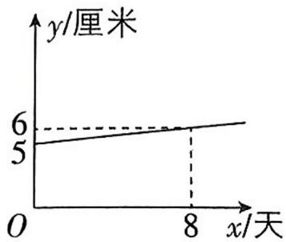

<!-- question-source:start -->
1. [2025 四川成都期末]某生物兴趣小组观察一种植物的生长情况,得到这种植物的高度 y(厘米)与观察时间 x(天)的函数关系图象如图所示。照此计算,该植物的高度生长到 12 厘米需要经过 ( )

A. 16 天 B. 32 天 C. 40 天 D. 56 天
<!-- question-source:end -->

![[Q00106388A1]]
