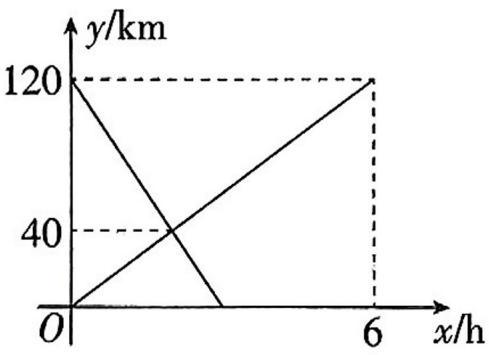

<!-- question-source:start -->
2[2025 广东深圳期中]甲从 A 地匀速骑电动车到 B 地, 乙从 B 地匀速骑摩托车到 A 地, 两人同时出发, 到达目的地后, 立即停止运动, 甲、乙两人与 A 地的距离 $y(\mathrm{km})$ 与他们骑车的时间 $x(\mathrm{h})$ 之间的函数关系如图所示, 则下列说法错误的是 ( )

A. A、B 两地的距离为 $120 \mathrm{~km}$ B. 甲的速度为 $20 \mathrm{~km} / \mathrm{h}$ C. 乙的速度为 $30 \mathrm{~km} / \mathrm{h}$ D. 乙骑车 $3 \mathrm{~h}$ 到达 A 地
<!-- question-source:end -->

![[Q00106006A1]]
