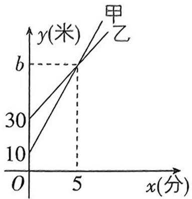

<!-- question-source:start -->
3 甲无人机从海拔 10 米处起飞,以 10 米/分的速度匀速上升,同时乙无人机从海拔 30 米处起飞,匀速上升,经过 5 分两架无人机位于同一海拔高度.无人机海拔高度 y(米)与上升时间 x(分)的关系如图,两架无人机都上升了 20 分.当甲无人机比乙无人机高 44 米时,两架无人机上升了\_\_\_\_分.

<!-- question-source:end -->

![[Q00106007A1]]
