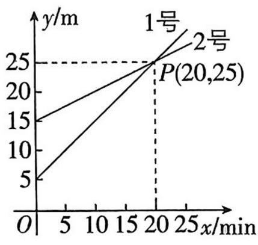
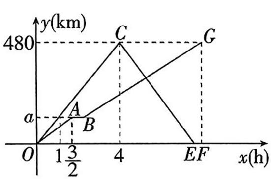

<!-- question-source:start -->
1 [2025 陕西西安期中, 中]已知 1 号探测气球从海拔 5 m 处匀速上升, 同时 2 号探测气球从海拔 15 m 处匀速上升, 两个气球所在位置的海拔 y (单位: m)与上升时间 x (单位: min)之间的函数关系如图所示. 下列说法: ① 上升 20 min 时, 两个气球海拔一样; ② 1 号探测气球所在位置的海拔 y 与上升时间 x 的函数关系式是 $y = x + 5$ ; ③ 当两个气球所在位置的海拔相差 5 m 时, 上升时间为 10 min 或 30 min; ④ 记两个气球的海拔差为 h, 则当 $0 \leqslant x \leqslant 50$ 时, h 的最大值为 15 m 其中, 说法正确的个数是 ( )

A. 1

B. 2

C. 3

D. 4

(第1题图)

(第2题图)
<!-- question-source:end -->

![[Q00106009A1]]
