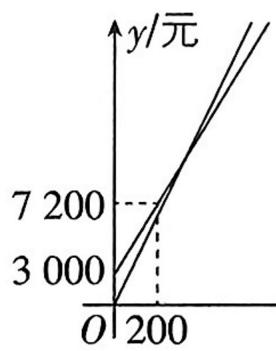

<!-- question-source:start -->
3[2025 河南郑州校级期中, 中]某物业进行绿化改造, 现需要购买大量的景观树树苗. 某苗木种植公司给出以下收费方案:

方案一:购买一张会员卡,所有购买的树苗按七折优惠;
方案二:不购买会员卡,所有购买的树苗按九折优惠.
设该物业购买的景观树树苗棵数为 x 棵,方案一所需费用 $y_{1}=k_{1}x+b_{1}(k_{1},b_{1}$ 为常数, $k_{1}\neq0$ ),方案二所需费用 $y_{2}=k_{2}x(k_{2}\neq0)$ ,其函数图象如图所示,请根据图象回答下列问题.
(1) $k_{1}=$ \_\_\_\_, $b_{1}=$ \_\_\_\_.
(2)求每棵树苗的原价.
(3)求按照方案二购买所需费用的函数关系式 $y_{2}=k_{2}x$ ,并说明 $k_{2}$ 的实际意义.
(4)若该物业需要购买景观树树苗600棵,采用哪种方案所需费用更少?请说明理由.

<!-- question-source:end -->

![[Q00106011A1]]
