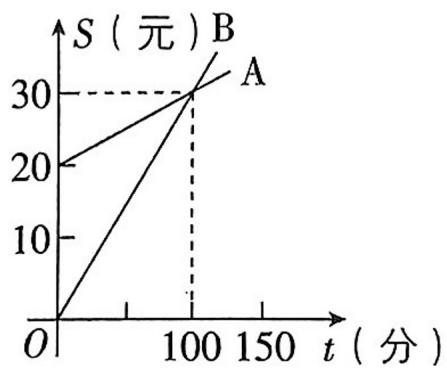

<!-- question-source:start -->
1. [2025 江苏徐州期末]电信公司的收费标准有 A, B 两类, 已知每月应缴费用 S(元)与通话时间 t(分)之间的关系如图所示. 当通话时间为 200 分钟时, 按这两类收费标准应缴费用的差为 ( )

A. 10 元
B. 15 元
C. 20 元
D. 30 元
<!-- question-source:end -->

![[Q00106389A1]]
