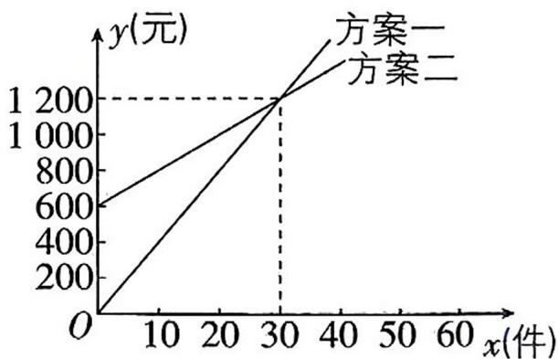

<!-- question-source:start -->
4[2023 浙江丽水中考]我市“共富工坊”问海借力,某公司产品销售量得到大幅提升.为促进生产,公司提供了两种付给员工月报酬的方案,如图所示,员工可以任选一种方案与公司签订合同.看图解答下列问题:
(1)直接写出员工生产多少件产品时,两种方案付给的报酬一样多;
(2)求方案二 y 关于 x 的函数表达式;
(3)如果你是劳务服务部门的工作人员,你如何指导员工根据自己的生产能力选择方案?

<!-- question-source:end -->

![[Q00106423A1]]
