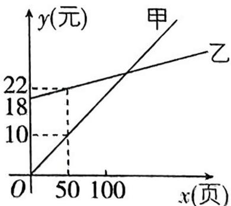

<!-- question-source:start -->
4.[2024 湖北襄阳期末,较难]小明同学需要经常去复印资料,甲复印社直接按每次复印的页数计费,乙复印社设会员制,但客户需按月支付一定的会员费.两复印社每月收费情况如图所示,根据图中提供的信息解答下列问题: (1)乙复印社要求客户每月支付的会员费是\_\_\_\_元,甲复印社每页收费是\_\_\_\_元. (2)求出乙复印社复印费用 $y$ 关于复印页数 $x$ 的函数表达式,并说明一次项系数的实际意义. (3)当每月复印多少页时,两复印社复印费用相同? (4)如果每月复印 200 页,应选择哪家复印社?

电子错题本鸭
<!-- question-source:end -->

![[Q00106424A1]]
