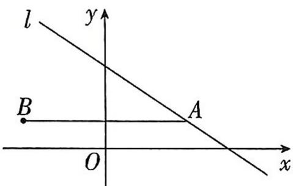

<!-- question-source:start -->
1 [2025 陕西咸阳质检, 中] 如图, 在平面直角坐标系中, 直线 $l: y = -\frac{2}{3} x + 3$ 经过点 $A$ , 点 $A$ 的横坐标为 3 , 点 $A$ 与点 $B$ 关于 $y$ 轴对称.

(1) 求点 $B$ 的坐标;

(2)将直线 $l$ 沿 $y$ 轴向下平移得到直线 $l'$ , $l'$ 与 $y$ 轴交于点 $C$ , 若 $\triangle ABC$ 的面积为 3, 求平移后的直线 $l'$ 的函数表达式.

<!-- question-source:end -->

![[Q00106013A1]]
