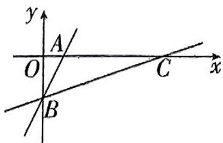

<!-- question-source:start -->
2[2024 江苏盐城调研, 中]如图, 在平面直角坐标系中, 一次函数 $y = 2x - 1$ 的图象分别交 $x$ 轴、 $y$ 轴于点 $A, B$ , 将直线 $AB$ 绕点 $B$ 按顺时针方向旋转 $45^\circ$ , 交 $x$ 轴于点 $C$ , 则直线 $BC$ 的函数表达式是\_\_\_\_.

<!-- question-source:end -->

![[Q00106014A1]]
