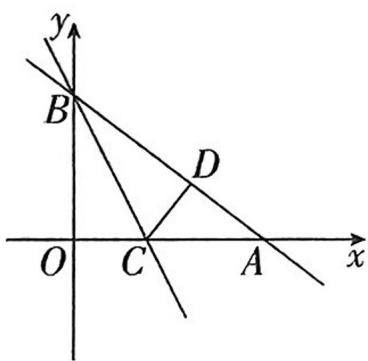

<!-- question-source:start -->
3[较难]如图,某个一次函数的图象与x轴、y轴分别交于A,B两点,且A,B两点的坐标分别为(4,0),(0,3).

(1) 求该一次函数的表达式.

建议用时 30 分钟 答案 D42

(2) 点 C 在线段 OA 上, 沿直线 BC 将 $\triangle OBC$ 翻折, O 点恰好落在 AB 上的 D 点处, 求直线 BC 的表达式.

(3) $x$ 轴上是否存在点 $P$ , 使 $\triangle ABP$ 为等腰三角形? 若存在, 请直接写出 $P$ 点坐标; 若不存在, 请说明理由.

<!-- question-source:end -->

![[Q00106015A1]]
