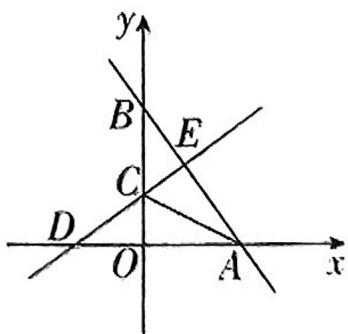
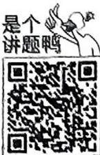
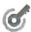

<!-- question-source:start -->
4[较难]如图,在平面直角坐标系中,一次函数 $y = -\frac{4}{3}x + 4$ 的图象分别与 $x$ 轴、 $y$ 轴交于点 $A, B$ , 点 $C$ 在线段 $OB$ 上, 将 $\triangle ABC$ 沿 $AC$ 翻折, 点 $B$ 恰好落在 $x$ 轴上的点 $D$ 处, 直线 $DC$ 交 $AB$ 于点 $E$ .

(1)求点 $C$ 的坐标.

(2)若点 $P$ 在直线 $DC$ 上, 点 $Q$ 是 $y$ 轴上一点 (不与点 $B$ 重合), 当 $\triangle CPQ$ 和 $\triangle CBE$ 全等时, 直接写出点 $P$ 的坐标: \_\_\_\_. (不包括这两个三角形重合的情况)

电子错题本鸭
<!-- question-source:end -->

![[Q00106016A1]]
