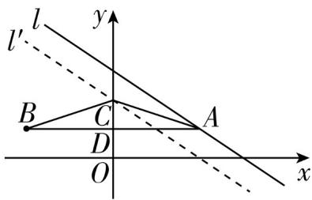

> [!success]- 必刷题
>
> > [!success] **【答案】** 详见解析
>
> > [!note]- **【解析】**
> > 【解】(1)把 x=3 代入 $y=-\frac{2}{3}x+3$ , 得 $y=-\frac{2}{3}\times3+3=1$ , 所以点 A(3,1).
> > 因为点 A 与点 B 关于 y 轴对称, 所以点 B 的坐标为 $(-3,1)$ .
> >
> > (2)由 $A(3,1), B(-3,$ 1)可知 $AB = 6$ . 如图，设 $AB$ 与 $y$ 轴的交点为 $D$ , 则 $D(0,1)$ . 因为
> >
> > 
> >
> > $S_{\triangle ABC}=3$ , 所以 $\frac{1}{2}AB \cdot CD = 3$ , 所以 $\frac{1}{2} \times 6CD = 3$ , 所以 CD = 1. 因为直线 $l'$ 是由直线 l 沿 y 轴向下平移得到的, 所以可设直线 $l'$ 的函数表达式为 $y = -\frac{2}{3}x + b$ .
> > - **①**：当点 C 在 AB 上方时, 点 C 的坐标为 (0, 2), 将 (0, 2) 代入 $y = -\frac{2}{3}x + b$ , 得 b = 2, 所以直线 $l'$ 的函数表达式为 $y = -\frac{2}{3}x + 2$ .
> >
> > ## 思路分析
> >
> > (3)由(1)(2)得出甲、乙两复印社的复印费用 $y$ 关于复印页数 $x$ 的函数表达式分别为 $y = 0.2x, y = 0.08x + 18$ , 令 $0.2x = 0.08x + 18$ , 解方程求出 $x$ 的值即可得出答案.
> >
> > 思路分析
> > 根据已知条件得到 $A\left(\frac{1}{2},0\right)$ ， $B(0,-1)$ ，求得 $OA=\frac{1}{2}$ ，OB=1，过 A 作 $AF\perp AB$ 交 BC 于 F，过 F 作 $FE\perp x$ 轴于 E，得到 AB=AF，根据全等三角形的判定和性质得到 AE=OB=1, EF=OA= $\frac{1}{2}$ ，求得 $F\left(\frac{3}{2},-\frac{1}{2}\right)$ ，再求直线 BC 的函数表达式即可得到答案.
> > - **②**：当点 C 在 AB 下方时, 点 C 的坐标为 $(0,0)$ , 将 $(0,0)$ 代入 $y = -\frac{2}{3}x + b$ , 得 b = 0, 所以直线 $l'$ 的函数表达式为 $y = -\frac{2}{3}x$ .
> > 综上, 平移后的直线 $l'$ 的函数表达式为 $y = -\frac{2}{3}x + 2$ 或 $y = -\frac{2}{3}x$ .
