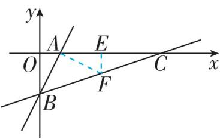

> [!success]- 必刷题
>
> > [!success] **【答案】** $y = \frac{1}{3}x - 1$
>
> > [!note]- **【解析】**
> > 因为一次函数 $y = 2x - 1$ 的图象分别交 $x$ 轴、 $y$ 轴于
> >
> > 
> >
> > 点 A, B, 令 x=0, 得 y=-1, 令 y=0, 得 $x=\frac{1}{2}$ , 所以 $A\left(\frac{1}{2},0\right)$ , $B(0,-1)$ , 所以 $OA=\frac{1}{2}$ , OB=1. 如图, 过 A 作 $AF \perp AB$ 交 BC 于 F, 过 F 作 $FE \perp x$ 轴于 E. 因为 $\angle ABC = 45^{\circ}$ , 所以 $\triangle ABF$ 是等腰直角三角形, 所以 AB = AF. 因为 $\angle OAB + \angle ABO = \angle OAB + \angle EAF = 90^{\circ}$ , 所以 $\angle ABO = \angle EAF$ , 所以 $\triangle ABO \cong \triangle FAE(AAS)$ , 所以 AE = OB = 1, $EF = OA = \frac{1}{2}$ , 所以 $F\left(\frac{3}{2}, -\frac{1}{2}\right)$ . 设直线 BC 的函数表达式为 $y = kx + b$ . 将 $B(0, -1)$ 代入得 b = -1, 所以 y = kx - 1, 将 $F\left(\frac{3}{2}, -\frac{1}{2}\right)$ 代入 y = kx - 1 得 $-\frac{1}{2} = \frac{3}{2}k - 1$ , 解得 $k = \frac{1}{3}$ , 所以直线 BC 的函数表达式为 y = $\frac{1}{3}x - 1$ . 故答案为 $y = \frac{1}{3}x - 1$ .
