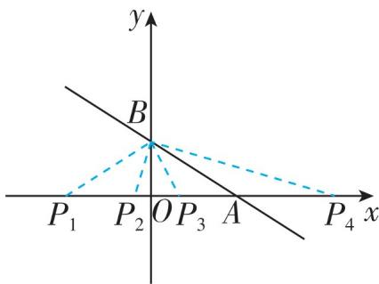

> [!success]- 必刷题
>
> > [!success] **【答案】** 详见解析
>
> > [!note]- **【解析】**
> > 【解】(1)设该一次函数的表达式为 $y = kx + b$ ( $k \neq 0$ ). 将 $B$ 点坐标 (0,3) 代入得 $b = 3$ , 再将 $A$ 点坐标 (4,0) 代入 $y = kx + 3$ , 解得 $k = -\frac{3}{4}$ , 所以 $y = -\frac{3}{4}x + 3$ . (2)由题意得 $OA = 4, OB = 3$ , 所以 $AB = 5$ . 由翻折可得 $OC = CD, BD = BO = 3$ , 所以 $AD = 2$ . 设 $CD = OC = x$ , 则 $AC = OA - OC = 4 - x$ . 在 Rt△ACD 中, 由勾股定理得 $CD^2 + AD^2 = AC^2$ , 即 $x^2 + 2^2 = (4 - x)^2$ , 解得 $x = \frac{3}{2}$ , 所以 $C$ 的坐标为 $\left(\frac{3}{2}, 0\right)$ . 设直线 BC 的表达式为 $y = mx + n (m \neq 0)$ . 将 $B$ 点坐标 (0,3) 代入得 $n = 3$ , 再将 $C$ 点坐标代入 $y=mx+3$ ，解得 m=-2，所以直线 BC 的表达式为 $y=-2x+3$ 。
> >
> > (3) 存在. $P$ 点坐标为 $(-4,0)$ 或 $(-1,0)$ 或 $(9,0)$ 或 $\left(\frac{7}{8}, 0\right)$ . 如图, 当 $AB = P_{1}B$
> >
> > 
> >
> > 时, 因为 AO = 4, 所以 $OP_{1} = AO = 4$ , 所以 $P_{1}(-4,0)$ . 当 $AB = AP_{2}$ 时, $OP_{2} = AB - AO = 1$ , 所以 $P_{2}(-1,0)$ . 当 $P_{3}A = P_{3}B$ 时, 设 $OP_{3} = x$ , 则 $BP_{3} = 4 - x$ , 所以 $3^{2} + x^{2} = (4 - x)^{2}$ , 解得 $x = \frac{7}{8}$ , 所以 $P_{3}\left(\frac{7}{8},0\right)$ . 当 $AB = AP_{4}$ 时, $AP_{4} = AB = 5$ , 所以 $OP_{4} = 4 + 5 = 9$ , 所以 $P_{4}(9,0)$ . 综上所述, x 轴上存在点 P, 使 $\triangle ABP$ 为等腰三角形, P 点坐标为 $(-4,0)$ 或 $(-1,0)$ 或 $(9,0)$ 或 $\left(\frac{7}{8},0\right)$ .
