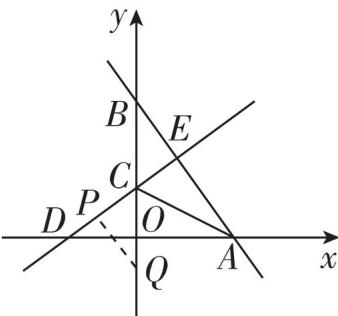
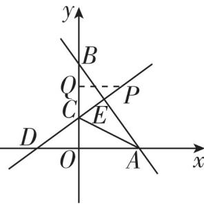

> [!success]- 必刷题
>
> > [!success] **【答案】** $(-2,0)$ 或 $(2,3)$ 或 $\left(-\frac{6}{5},\frac{3}{5}\right)$
>
> > [!note]- **【解析】**
> > 【解】(1)因为 $y=-\frac{4}{3}x+4$ ，令 x=0，则 y=4，令 y=0，则 x=3，所以 $A(3,0)$ ， $B(0,4)$ ，所以 OA=3，OB=4。因为 $\angle AOB=90^{\circ}$ ，所以由勾股定理得 $AB=\sqrt{OA^{2}+OB^{2}}=5$ 。因为将 $\triangle ABC$ 沿 AC 翻折，点 B 恰好落在 x 轴上的点 D 处，所以 AD=AB=5，所以 OD=2。设 OC=x，则 BC=DC=4-x。在 Rt $\triangle OCD$ 中，由勾股定理得 $x^{2}+2^{2}=(4-x)^{2}$ ，解得 $x=\frac{3}{2}$ ，所以 $C\left(0,\frac{3}{2}\right)$ 。
> >
> > (2)设直线 CD 的表达式为 $y=kx+b(k\neq0)$ 。将 C 点坐标 $\left(0,\frac{3}{2}\right)$ 代入得 $b=\frac{3}{2}$ ，再将 D 点坐标 $(-2,0)$ 代入 $y=kx+\frac{3}{2}$ ，解得 $k=\frac{3}{4}$ ，所以直线 CD 的表达式为 $y=\frac{3}{4}x+\frac{3}{2}$ 。
> >
> > 因为将 $\triangle ABC$ 沿 AC 翻折，点 B 恰好落在 x 轴上的点 D 处，所以 BC=CD， $\angle ABO=\angle CDO$ 。因为 $\angle BCE=\angle DCO$ ，所以 $\angle BEC=\angle COD=90^{\circ}$ 。由 (1) 得 $OC=\frac{3}{2}$ ， $BC=4-\frac{3}{2}=\frac{5}{2}$ 。
> > - **①**：当点 D 与 P 重合，点 Q 与 O 重合时， $\triangle CPQ\cong\triangle CBE$ ，此时 $P(-2,0)$ 。
> > - **②**：由①易知 BE=2，CE= $\frac{3}{2}$ 。如图 (1)，当 CQ=
> >
> > 思路分析
> > 分 $AB = P_{1}B$ , $AB = AP_{2}, AP_{3} = P_{3}B, AB = AP_{4}$ 四种情况讨论, 不要漏解.
> >
> > ## 思路分析
> >
> > (2)首先求出直线 $CD$ 的表达式，证 $\angle BEC = \angle COD = 90^{\circ}$ ，分①点 $D$ 与 $P$ ，点 $Q$ 与
> >
> > O 重合;
> > - **②**：CQ= $BC=\frac{5}{2}, CE=$ $CP=\frac{3}{2}, PQ=$ BE=2, $\angle CPQ=$ $\angle BEC = 90^{\circ}$ ;
> > - **③**：PQ = BE = 2, $CQ = CE = \frac{3}{2}$ , $\angle CEB = \angle CQP = 90^{\circ}$ 三种情况讨论,再分别求出点P的坐标即可.
> >
> > $BC = \frac{5}{2}$ ，即点 $Q$ 的纵坐标为-1， $CE = CP = \frac{3}{2},PQ =$ $BE = 2,\angle CPQ = \angle BEC =$ $90^{\circ}$ 时， $\triangle CPQ\cong \triangle CEB,$ 所以 $\frac{1}{2}\times (-x_P)\times \frac{5}{2} = \frac{1}{2}\times$
> >
> > 
> > 图(1)
> >
> > $\frac{3}{2} \times 2$ ，解得 $x_{P} = -\frac{6}{5}$ ，所以 $y_{P} = \frac{3}{4} \times \left(-\frac{6}{5}\right) + \frac{3}{2} = \frac{3}{5}$ ，所以 $P\left(-\frac{6}{5}, \frac{3}{5}\right)$ .
> > - **③**：如图(2)，当 PQ=BE=2， $CQ = CE = \frac{3}{2}, \angle CEB =$ $\angle CQP = 90^{\circ}$ 时， $\triangle CPQ \cong$ $\triangle CBE,$ 所以 $x_{P}=2,$ 所以 $y_{P}=\frac{3}{4}\times2+\frac{3}{2}=3,$ 所以 $P(2,3).$
> >
> > 
> > 图(2)
> >
> > 综上, 点 P 的坐标为 $(-2,0)$ 或 $(2,3)$ 或 $\left(-\frac{6}{5},\frac{3}{5}\right)$ . 故答案为 $(-2,0)$ 或 $(2,3)$ 或 $\left(-\frac{6}{5},\frac{3}{5}\right)$ .
