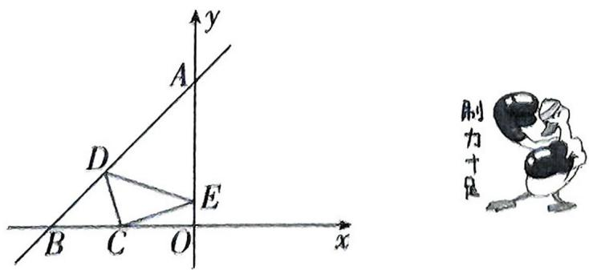

<!-- question-source:start -->
3[中]如图所示, 直线 $y = x + 4$ 与两坐标轴分别交于 A, B 两点, 点 C 是 OB 的中点, D, E 分别是直线 AB 和 y 轴上的动点, 则 $\triangle CDE$ 周长的最小值是 \_\_\_\_.

建议用时 45 分钟 答案 D43
<!-- question-source:end -->

![[Q00106019A1]]
